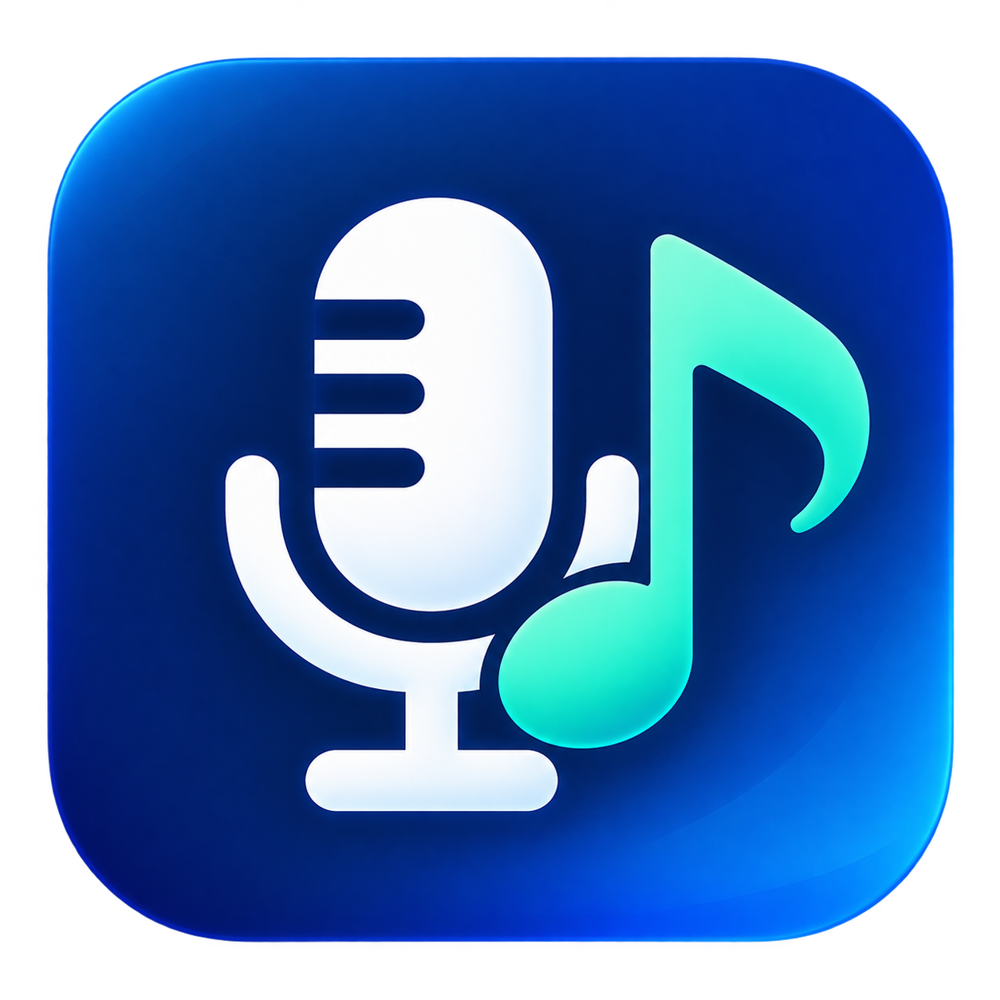

<p align="center"></p>

# VoiceBridge

创建自己的 VoiceBridge 房间：选择 QQ音乐、网易云音乐或酷狗音乐作伴奏，邀请朋友用浏览器进房间，同时讲话、听立体声音乐。音乐与人声分别传送、分别调音量，本机耳机仍正常播放。

**当前公开测试版：v0.8.2，适用于 Windows 11 x64。普通 Windows 10 19045 不支持本项目采用的进程音频捕获接口。**

## 下载使用

- **[下载 VoiceBridge.exe](https://github.com/zhangmingfeng962-cyber/VoiceBridge/releases/download/v0.8.2/VoiceBridge.exe)**
- [版本说明、源码包和 SHA-256 校验值](https://github.com/zhangmingfeng962-cyber/VoiceBridge/releases/tag/v0.8.2)

EXE 自带 .NET / ASP.NET Core 运行时，可直接放到桌面双击。**只使用独立音乐链接时无需虚拟声卡或麦克风。** 原来的虚拟麦克风功能仍需安装设备：应用内附带 **VB-Audio 官方 VB-CABLE 原包**，由用户批准管理员授权并按原厂提示完成安装、重启。已安装 VB-CABLE 时无需重装。

VB-CABLE 是原作者的 donationware，保留其独立许可和捐赠方式。VoiceBridge 的 MIT 许可不涵盖该驱动。详情见[第三方声明](third-party/NOTICE.zh-CN.md)。

## 国内中继与桌面配置

新版增加“导入中继配置”和“检查中继连接”。本机专用便携包中的 `.vbrelay` 由当前 Windows 用户 DPAPI 保护，不能作为公共发送配置分享。首次启动会在用户配置缺失时保存同目录便携配置；已有配置请显式导入。未配置跨网服务时不再自动尝试临时隧道，创建失败会释放本次捕获并允许重试。

原因与国内容器部署说明见 [国内中继与桌面配置](docs/DOMESTIC-RELAY.md)。公共 EXE 仍不含任何账户的发送密钥。

## 音乐语音房间

选择“伴奏来源”并播放音乐，点击“创建音乐房间”，上传确认后“邀请朋友”。主持人点击“进入语音房间”，朋友打开完整邀请；双方在浏览器中进入房间，主动开启麦克风后即可讲话，默认不采集麦克风。最多 8 人。

伴奏独立开关、固定音量；主持人页面默认音乐 0%，避免与本机播放器重叠。音乐保持 48 kHz 立体声，人声使用独立加密 WSS 通道。音乐不经过人声降噪，不会随讲话自动压低。语音的延迟与音乐缓冲不同，尚未实现精确同步。完整说明见 [房间教程](docs/ROOMS.md)。

原来的虚拟麦克风功能在折叠的兼容设置中。旧 /listen 链接仍只收听音乐。

## 独立音乐链接：优先保留音乐

在界面上方创建音乐房间，朋友也可只点击“开始收听”听音乐，不进入语音或开启麦克风。人声可继续通过原来的 QQ、微信或游戏交流。

配置自己的 HTTPS 中继后，音乐以 48 kHz 双声道未压缩 PCM 加密上传一次，再由服务器分发给朋友，不进入 QQ、微信或游戏的语音过滤。朋友无需账号或安装接收软件；完整链接包含本次解密 / 收听密钥。默认接收缓冲 2.4 秒，可选 1.2 / 2.4 / 4.8 秒。为保留音乐而增加了延迟，**不满足端到端 <100 ms，也不保证零断流或所有设备听感完全一致**。

接收端通过服务器等待新片段，减少后台浏览器计时器造成的抖动；遇到严重过期队列时保留可播放缓冲。发送凭据用 Windows DPAPI 保存在本机，不包含在公共 EXE / 源码中。公共下载不附带本账户的发送权限，其他分享者需部署和配置自己的服务。部署方法与免费限制见 [HTTPS 跨网音乐](docs/HTTPS-RELAY.md) 和 [中继服务代码](relay/README.md)。

关闭 / 最小化后继续分享；停止会请求撤销，断网时房间最迟在最后上传 120 秒后过期，每次重新开始生成新密钥。免费托管可能休眠、限流或重启；首次唤醒可能需要约一分钟。原临时反向隧道作为兼容路径保留，说明见 [旧链接方式](docs/MUSIC-LINK.md)。

## 虚拟麦克风快速开始

1. 使用耳机，在 Windows 中将默认播放设备和默认通信播放设备都设置为正常耳机。**不要设为 CABLE Input。**
2. 打开 QQ音乐、网易云音乐或酷狗音乐的 Windows 桌面客户端，保持它原来的耳机输出，正常播放。
3. 打开 VoiceBridge，在“音乐来源”选择对应播放器，选择真实麦克风；发送端选择 `CABLE Input (VB-Audio Virtual Cable)`。
4. 在目标游戏或语音软件中，将输入 / 麦克风选择为 **`CABLE Output (VB-Audio Virtual Cable)`**，输出 / 扬声器选择耳机。
5. 点击“人声”或“音乐”的独立开关。可以只传人声、只传音乐，也可以同时开启。两路全关后停止采集。

找不到设备时先重启并刷新；默认播放误指向线缆时，可点击“修复播放路由”。修复会参照现有的正常默认播放设备，并先保存本地备份。

## 功能

- **三个可选音乐来源**：QQ音乐、网易云音乐、酷狗音乐；记住选择，一次共享一个播放器。
- **独立音乐链接**：独立选择播放器；朋友用浏览器收听，不把音乐送进语音软件；最多 8 人，密钥认证，停止后撤销。
- **独立场景配置**：通用、QQ、微信、无畏契约、和平精英模拟器，分别保存来源、设备、音量、音乐声道和输出缓冲。
- **本地虚拟输出检查**：手动录制最多 10 秒 WAV，耳机试听并显示电平；本地检查与用户记录的接收端反馈分别显示。
- **默认输入路由助手**：手动备份并统一 Windows 默认输入到虚拟麦克风，可恢复；只对使用系统默认输入的软件起作用。
- **仅按所选播放器进程树捕获**：使用 Windows Process Loopback，不使用系统立体声混音，不捕获整个耳机输出；嵌套进程只建立一次捕获。
- **独立人声和音乐开关 / 音量**：人声 0–200%，音乐 0–100%，开关使用平滑过渡。
- **固定音乐增益**：人声过载时只对人声削峰，避免把音乐一起压低；混音预留固定余量。
- **系统托盘**：关闭或最小化窗口后继续运行，左键恢复，右键控制声音、音量、全部停止或退出。
- **开机自启动开关**：主界面上方一键开启 / 关闭；开启后随当前用户登录 Windows 启动并收起到托盘，人声和音乐仍默认关闭。
- **全局快捷键**：游戏中也可通过已注册的快捷键控制。
- **单文件发布**：运行时、图标、许可和官方组件包都内置于 EXE。
- **本地诊断**：导出设备和路由信息；默认不保存录音。独立分享只在明确点击开始后向收听者传输选定音乐。

| 快捷键 | 操作 |
|---|---|
| Ctrl + Alt + F8 | 开关人声 |
| Ctrl + Alt + F9 | 开关音乐 |
| Ctrl + Alt + ↑ / ↓ | 音乐音量 ±5% |

右上角 **×** 会收起到托盘。完全退出请右键托盘图标选择 **“退出程序”**。图标可能位于右下角“显示隐藏的图标”中。每次重新启动软件，两路声音都默认关闭。

## 网易云音乐与酷狗音乐

在“音乐来源”下拉框中选择播放器，再开启“音乐”独立开关。程序会自动等待该客户端启动，也会在进程退出 / 重启后重新识别。托盘菜单显示当前所选播放器。

| 来源 | Windows 桌面主进程 |
|---|---|
| QQ音乐 | `QQMusic.exe` |
| 网易云音乐 | `cloudmusic.exe` |
| 酷狗音乐 | `KuGou.exe` |

识别不区分大小写，捕获范围为选定主进程及其子进程。切换来源前点击“全部停止”；选择后再打开需要的人声 / 音乐。可以同时打开多个播放器，本软件只选择当前来源的进程树。网页版或使用其他主进程名的版本需要另行适配。

此功能共享客户端当前播放的音频，播放器需自行安装。新来源已通过进程树筛选、去重及界面测试；发布环境未安装网易云音乐和酷狗音乐，尚未完成这两个真实客户端的播放与队友端验收。平台的强制降噪 / 语音编码限制仍然适用。

## 开机自启动

先把 `VoiceBridge.exe` 放到桌面或其他固定位置，再点击主界面上方的 **“开机自启动：关”**，显示 **“开机自启动：开”** 即已登记。再次点击可关闭，设置立即保存，不需要管理员权限。登录 Windows 后程序只出现在托盘，左键图标或再次双击 EXE 可显示主窗口；如果托盘创建失败，会显示窗口，避免程序藏起后无法操作。

自启动只登记当前用户的 `HKCU\Software\Microsoft\Windows\CurrentVersion\Run\VoiceBridge`，不会自动开启人声或音乐，也不会自动安装驱动。退出程序不会取消已开启的自启动。

更新时完全退出旧版，将新版 EXE 覆盖到同一路径即可。移动或改名后，请在新位置重新打开，关闭再开启此开关以更新路径；如果按钮旁提示路径改变，也按此操作。若 Windows 曾禁用启动项，请在 **设置 → 应用 → 启动** 中允许 VoiceBridge；Windows 可能延后运行启动项。删除 EXE 前请先关闭自启动。

## QQ、微信和游戏中的音乐过滤

在“使用场景”选择目标，调整并保存该场景的本机参数。首次配置使用中性起点，不代表已经找到该软件的最佳设置。展开“音频参数、输出检查与试听记录”可调整音乐声道 / 输出缓冲、检查默认输入、录制和试听虚拟输出，并记录对方实际反馈。

**本版本不承诺全平台取消过滤、无损传输或与本地完全一致。** 场景配置不会修改 QQ、微信或游戏的内部处理；本地录音、零丢帧和用户反馈标记都不是平台过滤已消失的自动证明。使用步骤、路由恢复范围和接收端校准见 [场景配置与检查](docs/SCENARIOS.md)。

## 音量变小、音乐失真或断续

语音软件或浏览器可能对虚拟麦克风再次做自动增益、噪音抑制和回声消除，音乐可能被当作噪声而逐渐变小。请在平台提供相关选项时关闭这些处理，开启原声 / 音乐 / 高音质模式。浏览器麦克风测试页面也需要检查这些开关；修改后重新录制，已有录音不会恢复。

VoiceBridge 的“关闭通话自动压低音量”只修改 Windows 的通话减音偏好，并先备份原值；它不能关闭第三方平台自己的音频处理。详细排查见[音质与路由说明](docs/AUDIO.md)。

## 支持范围与实际限制

| 项目 | 当前状态 |
|---|---|
| 系统 / 架构 | Windows 11 x64；未提供普通 Win10、x86、ARM64 的功能支持保证 |
| 混音格式 | 内部 48 kHz、float32、双声道；语音平台可能另行压缩或降采样 |
| 虚拟设备 | 依赖 VB-CABLE 驱动，需要管理员安装，部分步骤需要重启 |
| 回声 | 避免系统声音的数字回传；真实扬声器串入麦克风的声学回声仍需通过耳机等方式处理 |
| 延迟 | 以低延迟为目标，尚未完成端到端 <100 ms 验收 |
| 音质 | 没有“所有平台和本地完全一致”“绝无底噪”的保证；源音频、硬件及平台处理均会影响结果 |
| 游戏 / 反作弊 | 没有游戏注入、内存修改或检测绕过；仍需按各游戏政策实测，不能保证所有反作弊兼容 |
| 测试范围 | DSP、资源和窗口 / 托盘测试，以及部分合成音虚拟线缆验证；不等同于所有真实通话平台验收 |

## 自行编译

需要 Windows x64 和 .NET 8 SDK；`global.json` 固定为 8.0.426，并允许兼容的同带补丁版本。NuGet 依赖通过 `packages.lock.json` 锁定。

```powershell
git clone https://github.com/zhangmingfeng962-cyber/VoiceBridge.git
cd VoiceBridge
.\scripts\build.ps1
```

发布结果在 `artifacts\publish\VoiceBridge.exe`。如果只需要发布单文件：

```powershell
.\scripts\publish-portable.ps1
```

详见[构建与测试](docs/BUILD.md)。应用编译不需要 WDK，不会自行生成或伪造驱动签名。

## 项目结构

```text
src/VoiceBridge.Core       浮点混音、缓冲与音量处理
src/VoiceBridge.App        WPF 界面、进程捕获、虚拟设备与托盘
tests                     单元测试及显式启用的合成音集成测试
scripts                   构建、单文件发布与图标转换
third-party               原厂驱动 ZIP 与第三方许可
docs                      使用、排查和测试说明
```

## 配置、隐私与卸载

配置、轮转日志和路由 / 通话音量设置备份位于 `%LOCALAPPDATA%\VoiceBridge`。诊断报告包含端点名称、系统版本、路由、所选播放器及各受支持播放器的根进程 ID；分享报告前请自行检查。不要提交包含私人设备信息的日志、录音或配置。

退出托盘程序后可删除 EXE。删除 EXE 不会卸载 VB-CABLE；卸载驱动请使用原厂安装器并按提示重启。移除前确认其他软件没有依赖它。

## 许可与反馈

原创代码采用 [MIT](LICENSE)。VB-CABLE、NAudio、WDL、.NET 运行时保留各自许可，见 [third-party](third-party/NOTICE.zh-CN.md)。VB-CABLE 官方来源为 [VB-Audio](https://vb-audio.com/Cable/)，发现有用时请向原作者捐赠或购买适合自己使用场景的许可。

图标源文件、转换脚本和生成记录包含在 [Assets](src/VoiceBridge.App/Assets/README.zh-CN.md) 中。

问题反馈可提交 [Issue](https://github.com/zhangmingfeng962-cyber/VoiceBridge/issues)，请注明软件版本、Windows 版本、语音平台及复现步骤，不要上传隐私录音或未经检查的设备报告。
